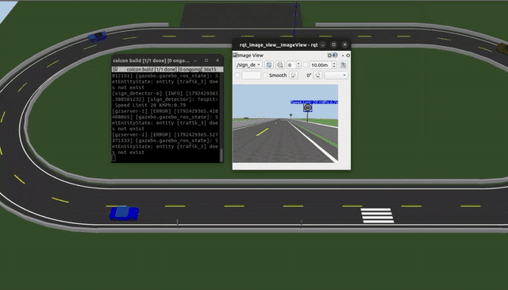
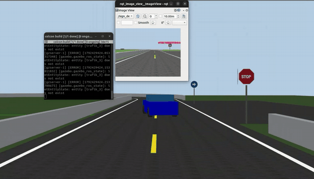
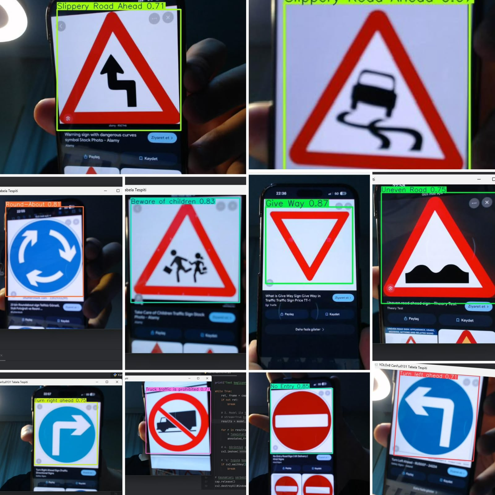
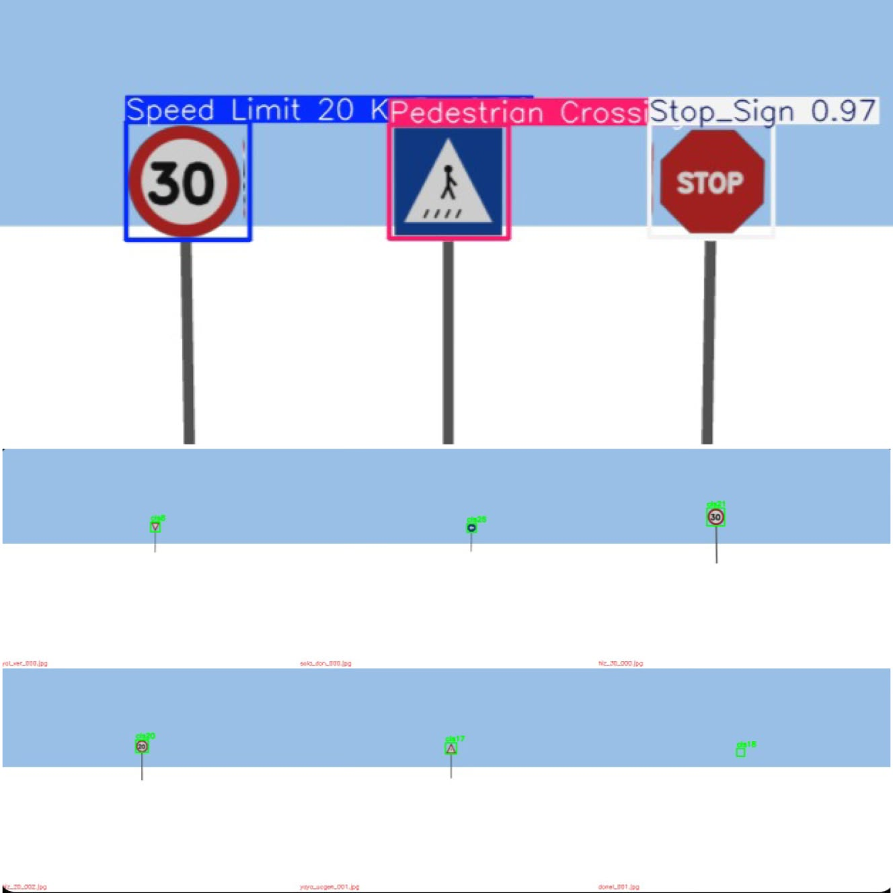

<h1 align="center">TORCA</h1>
<p align="center"><b>Traffic-aware Obstacle Routing &amp; Cognitive Autonomy</b></p>

<p align="center">
  Gazebo'da simüle edilen tam ölçekli Ackermann aracı için uçtan uca
  ROS 2 algılama ve kontrol yığını.<br>
  Kamera tabanlı şerit takibi · YOLOv8 ile trafik tabelası tanıma ·
  LiDAR tabanlı engel kaçınma · tabelaya tepkili manevra planlama.
</p>

<p align="center">
  
  
  
  
  
</p>

---

## Demo

<p align="center">
  
  <br><sub><i>Oval pist genel görünümü · şerit takibi ve NPC trafik akışı</i></sub>
</p>

<p align="center">
  
  <br><sub><i>Araç görüşü · şerit takibi, canlı tabela tespiti ve DUR reaksiyonu</i></sub>
</p>

<p align="center">
  <b><a href="docs/media/demo.mp4">▶ Tam demo videosunu izle (41 sn, 720p, sesli)</a></b>
</p>

Showcase senaryosunda araç tek turda şu diziyi kesintisiz tamamlar:

| # | Olay | Aracın tepkisi |
|---|------|----------------|
| 1 | **Hız Limiti** tabelası | Hedef hızı tabela değerine çeker |
| 2 | **Yaya Geçidi** tabelası | Zebra geçidine yaklaşırken yavaşlar |
| 3 | **Dönel Kavşak** tabelası | Tanır ve raporlar |
| 4 | **DUR** tabelası | Tam duruş, 3 sn bekleme, ardından kalkış |
| 5 | **Sağa Dön** tabelası | 8 fazlı scripted U-dönüşü, sonra şeride geri oturur |
| 6 | **Yoldaki engel** | LiDAR ile algılar, şerit değiştirerek sollar, şeride döner |

Sahnede eşzamanlı olarak 3 NPC trafik aracı dolaşır; algılama ve güvenlik
katmanı hareketli trafikle birlikte çalışır.

---

## Tabela tanıma

### Gerçek dünya — bilgisayar kamerasıyla canlı test

<p align="center">
  
</p>

Model, dizüstü bilgisayarın kamerasına gösterilen gerçek trafik tabelası
görsellerini canlı akışta tanıyor. Simülasyon dışında, değişken ışık ve
açı altında alınan örnek güven skorları:

| Sınıf | Güven | | Sınıf | Güven |
|---|---|---|---|---|
| Give Way | **0.87** | | No Entry | **0.85** |
| Beware of children | **0.83** | | Round-About | **0.81** |
| Truck traffic is prohibited | **0.77** | | Uneven Road | **0.75** |
| Turn right ahead | **0.75** | | Turn left ahead | **0.71** |
| Slippery Road Ahead | **0.71** | | Dangerous Curve | **0.71** |

### Simülasyon tespiti ve sentetik eğitim verisi

<p align="center">
  
</p>

**Üstte:** Gazebo sahnesinde `Stop_Sign` **0.97**, `Pedestrian Crossing` ve
`Speed Limit` tespitleri.
**Altta:** Fine-tuning için `tools/veri_topla.py` tarafından üretilen,
bounding box'ları otomatik etiketlenmiş sentetik kareler.

---

## Model eğitim süreci

Projenin en belirleyici mühendislik kararı burada alındı.

### 1 · Taban model

Roboflow üzerindeki **Traffic and Road Signs** veri seti (29 sınıf, gerçek
dünya fotoğrafları) ile Google Colab'da YOLOv8n eğitildi. Model gerçek
fotoğraflarda ve kamera önüne tutulan tabelalarda başarılı çalıştı.

### 2 · Domain gap problemi

Aynı model Gazebo sahnesinde test edildiğinde **mAP50 = %2.25** çıktı.
Sebep domain gap: ağ yalnızca gerçek dünya dokularıyla eğitilmişti,
simülasyonun düz renkli ve gölgesiz tabelalarını tanıyamıyordu.
Çoğu sınıfta recall sıfırdı.

### 3 · Sentetik veri üretimi

Gerçek veri toplamak yerine simülasyonun kendisi veri kaynağına dönüştürüldü:

```
tools/tabela_uret.py         → tabela dokularını prosedürel üretir
tools/tabela_model_uret.py   → dokulardan Gazebo SDF modelleri kurar
tools/veri_topla.py          → sahnede tabelaları farklı mesafe/açılarda
                               konumlandırıp kare kaydeder; bbox etiketleri
                               projeksiyon geometrisinden ANALİTİK üretilir
```

Etiketleme tamamen otomatiktir — tek bir kare bile elle etiketlenmedi.

### 4 · Fine-tuning

```bash
python3 tools/model_egit.py --veri /tmp/tabela_veri --epoch 40
```

| Metrik | Taban model | Fine-tune sonrası |
|---|---|---|
| **mAP50** | 0.0225 | **0.482** · *21× iyileşme* |
| **Recall** | çoğu sınıfta 0.00 | **0.45 – 0.67** |
| Eğitim süresi | — | ~3.5 dk (RTX 4050, 40 epoch) |
| Model boyutu | 24 MB | **6 MB** |

**Bilinen zayıflık:** Hız limiti 20 ↔ 30 ayrımı. Rakam ayırt etmek daha
yüksek çözünürlüklü veya daha yakın mesafeli örnek gerektiriyor.
Dürüstlük adına raporlanmıştır.

Çalışma zamanında `sign_detector` fine-tune edilmiş ağırlığı otomatik
tercih eder, bulunamazsa taban modele düşer.

---

## Hızlı başlangıç

```bash
cd ~/ros2_ws
source /opt/ros/humble/setup.bash
colcon build --packages-select perception_pkg
source install/setup.bash
ros2 launch perception_pkg otonom_surus.launch.py
```

Araç dünyada doğar, şerit takip ederek oval pisti süresiz döner, tabelalara
tepki verir ve önüne çıkan engeli güvenle sollar.

### Showcase — tek komutla tüm yetenekler

```bash
python3 src/perception_pkg/worlds/generate_otoban.py --showcase -o showcase.world
ros2 launch perception_pkg otonom_surus.launch.py trafik:=3 world:=$PWD/showcase.world
```

### Canlı kamera görüntüsü

```bash
ros2 run rqt_image_view rqt_image_view /sign_detector/annotated
```

### Launch argümanları

| Argüman | Varsayılan | Açıklama |
|---|---|---|
| `world` | `otoban.world` | Yüklenecek Gazebo dünyası |
| `gui` | `true` | gzclient arayüzü açılsın mı |
| `rviz` | `true` | RViz açılsın mı |
| `algilama` | `true` | `sign_detector` + `serit_takip` çalışsın mı |
| `guvenlik` | `true` | LiDAR güvenlik katmanı aktif mi |
| `trafik` | `0` | Sahneye eklenecek NPC araç sayısı |
| `use_sim_time` | `true` | Düğümler Gazebo saatini kullansın |

```bash
# Başsız — araç dinamiği testi için algılamayı da kapat
ros2 launch perception_pkg otonom_surus.launch.py gui:=false rviz:=false algilama:=false

# İzole engel senaryosu
python3 src/perception_pkg/worlds/generate_otoban.py --engel-s 45 -o engel.world
ros2 launch perception_pkg otonom_surus.launch.py world:=$PWD/engel.world
```

---

## Mimari

```
                    ┌─────────────────────┐
   /arac/kamera/    │                     │  /detected_sign
   image_raw ─────▶ │   sign_detector     │ ───────────┐
                    │   (YOLOv8, 6 Hz)    │            │
                    └─────────────────────┘            │
                             │ /sign_detector/annotated │
                             ▼                          ▼
                    ┌─────────────────────┐    ┌─────────────────────┐
   /arac/kamera/    │   serit_takip       │    │ tabela reaksiyonu   │
   image_raw ─────▶ │   HSV + IPM +       │ ◀──┤ (hız limiti, DUR,   │
   /arac/odom  ───▶ │   saf takip         │    │  yaya, sağa dön...) │
                    └─────────────────────┘    └─────────────────────┘
                             │ /arac/cmd_vel_cmd
                             ▼
                    ┌─────────────────────┐
   /arac/scan  ───▶ │   guvenlik          │ ──▶ /arac/cmd_vel
                    │ (koridor + kaçınma) │
                    └─────────────────────┘
                             │
                             ▼
                      ackermann_drive eklentisi
```

`serit_takip` doğrudan `cmd_vel`'e yazmaz; komutu `cmd_vel_cmd` üzerinden
`guvenlik` düğümüne geçirir. Böylece `cmd_vel`'de tek yayıncı kalır ve
güvenlik katmanı son söz hakkına sahip olur — LiDAR'da engel görürse hız
komutunu kırpar, sıfırlar veya kaçınma ofseti uygular.

### Düğümler

| Düğüm | Girdi | Çıktı | Sorumluluk |
|---|---|---|---|
| `sign_detector` | `/arac/kamera/image_raw` | `/detected_sign`, `/sign_detector/annotated` | YOLOv8 çıkarımı, 6 Hz throttle, bbox yüksekliği + sınıf süzgeci |
| `serit_takip` | kamera, `/arac/odom`, `/detected_sign` | `/arac/cmd_vel_cmd` | Şerit algılama, saf takip kontrolü, tabela davranışları, U-dönüşü |
| `guvenlik` | `/arac/scan`, `/arac/cmd_vel_cmd` | `/arac/cmd_vel` | Yay-duyarlı koridor taraması, fren, şerit değiştirerek kaçınma |
| `trafik` | — | Gazebo model pozları | Pist üzerinde NPC araçları dolaştırır |

---

## Algılama hattı

### Şerit takibi

Önceki Canny + HoughLinesP yaklaşımı ölçümde **tek bir çizgi bile
bulamıyordu**; iki liste de boş kalınca şerit merkezi görüntü merkezine
düşüyor, hata sıfır çıkıyor ve araç "şerit takip ettiğini sanarak" ilk
virajda pistten çıkıyordu. Mevcut hat bu hatayı dört noktada düzeltir:

1. **Renk tabanlı sınıflandırma** — Sarı = orta çizgi (solda),
   beyaz = dış kenar (sağda). Dünya bu iki rengi ayırarak üretildiği için
   sınıflandırma eğim tahminine değil renge dayanır; virajda bozulmaz.
2. **Analitik IPM** — Homografi 4 nokta elle seçilerek değil, kameranın iç
   ve dış parametrelerinden türetilir. URDF'te kamera yüksekliği veya eğimi
   değiştiğinde dönüşüm kendiliğinden doğru kalır. Böylece kontrol **metrik
   uzayda** çalışır, piksel uzayında değil.
3. **Kayan pencere** — Her çizgi bir önceki tahminin çevresinde aranır;
   iç kenar çizgisi dış kenarla karıştırılmaz.
4. **Saf takip (pure pursuit)** — Kontrolcü doğrudan **direksiyon açısı**
   üretir. Ölçümle doğrulandı: `ackermann_drive` eklentisi
   `cmd_vel.angular.z`'yi yönelme hızı değil direksiyon açısı olarak
   yorumluyor. Hız, yol eğriliğine göre uyarlanır.

Şerit kaybında araç yavaşlar; kayıp sürekliyse durur.

### Tabela tepkisi

Mesafe ölçütü olarak **bbox yüksekliği** kullanılır. Tabela mesh'leri
ölçekli olduğundan metrik mesafe türetmek güvenilir değil; eşik
`tools/tabela_kalibre.py` ile deneysel kalibre edildi — gerçek tespitler
47.6–106.9 px, uzak yanlış pozitifler ≤33.7 px. **35 px** ikisini temiz ayırır.

### Güvenlik katmanı

Fren mesafeleri tahmin değil, `tools/fren_olcum.py` ile ölçüldü:

```
6.9 m/s  →  fren yolu 9.64 m,  ortalama ivme 2.00 m/s²
```

Önceki varsayılanlar (ivme 4.0 m/s², yavaşlama 6 m) fiziksel olarak
imkânsızdı: araç 7 m/s'de 9.6 m'ye ihtiyaç duyarken engeli 6 m'de fark
edip çarpıyordu. Koridor yarı genişliği gövde genişliğinden (1.85 m)
pay bırakacak şekilde 1.20 m seçildi.

---

## Ölçülen davranış

Rakamlar `tools/` altındaki ölçüm araçlarıyla toplandı — tahmin yok.

**Oval pistte 150 s şerit takibi**

```
kat edilen yol  : 590 m (2.13 tur)
ortalama hız    : 3.96 m/s
şerit sapması   : ort 0.14 m · maks 0.85 m
    düz bölümde : 0.27 m
    virajda     : 0.07 m
```

**Engel senaryosu** — yolda duran 1.2 m genişliğinde kutu:

```
güvenlik AÇIK   : araç engelin 2.0 m öncesinde yavaşlayarak durdu
güvenlik KAPALI : kontrolcü 6.88 m/s komut vermeye devam etti,
                  araç engele dayanarak durdu (algılama yok)
```

---

## Ölçüm araçları

| Araç | Ne ölçer |
|---|---|
| `tur_testi.py` | Tur sayısı, şerit sapması (düz/viraj ayrı), ortalama hız |
| `sapma_tani.py` | Sapmanın kaynağı: algıda mı, kontrolde mi |
| `fren_olcum.py` | Gerçek fren yolu ve ortalama yavaşlama ivmesi |
| `engel_testi.py` | Engele en yakın mesafe (güvenlik var/yok karşılaştırması) |
| `tabela_kalibre.py` | Tabela mesafesi ↔ bbox yüksekliği eşlemesi |

```bash
python3 src/perception_pkg/tools/tur_testi.py 150
```

Bu araçlar projenin iddialarını ölçülebilir kılmak için var.

---

## Proje yapısı

```
src/perception_pkg/
├── perception_pkg/
│   ├── serit_takip.py            # HSV + IPM + saf takip kontrolcüsü
│   ├── sign_detector.py          # YOLOv8 tabela algılama
│   ├── guvenlik.py               # LiDAR koridor + engel kaçınma
│   ├── trafik.py                 # NPC trafik araçları
│   ├── ipm.py                    # analitik ters perspektif dönüşümü
│   └── weights/
│       ├── best.pt               # taban model (gerçek foto)
│       └── best_finetuned.pt     # sentetik veriyle fine-tune — kullanılan
├── launch/otonom_surus.launch.py # olay tabanlı başlatma
├── urdf/otonom_arac.urdf.xacro   # Ackermann araç + kamera + IMU + LiDAR
├── worlds/generate_otoban.py     # oval pisti parametrik üreten script
├── models/                       # Gazebo tabela modelleri
└── tools/                        # veri üretimi, eğitim, ölçüm araçları
```

> **Dünya dosyaları elle düzenlenmez.** Gazebo GUI'den "Save World" bir
> `<state>` bloğu yazıp model pozlarını sessizce ezer. Pisti değiştirmek
> için `generate_otoban.py`'ı düzenleyip yeniden çalıştırın.
> `otoban.world` ve `showcase.world` bu yüzden `.gitignore`'dadır.

---

## Teknik yığın

| Bileşen | Teknoloji |
|---|---|
| Orta katman | ROS 2 Humble (rclpy), ament_python, colcon |
| Simülasyon | Gazebo Classic 11, `ackermann_drive` eklentisi |
| Araç | 4.0 × 1.8 m · 2.5 m dingil · 1200 kg · Ackermann direksiyon |
| Sensörler | Kamera 640×480 @ 80° FOV 30 Hz · 2D LiDAR ±90° 60 m 15 Hz · IMU 100 Hz |
| Şerit takibi | HSV maske + analitik IPM homografi + saf takip |
| Tabela tanıma | YOLOv8 (ultralytics), fine-tune, 6 Hz, bbox + sınıf süzgeci |
| Görüntü işleme | OpenCV, NumPy, cv_bridge |

---

## Önkoşullar

- ROS 2 Humble (`gazebo_ros`, `cv_bridge`, `rviz2`, `xacro`)
- Python 3.10+
- `ultralytics`, `opencv-python`, `numpy`
- `~/.gazebo/models/` altında `asphalt_plane` (standart Gazebo model deposundan)

---

## Lisans

Apache-2.0 · Bakımcı: Ibrahim Tarik Solak &lt;ibrahimtariksolak.is@gmail.com&gt;
